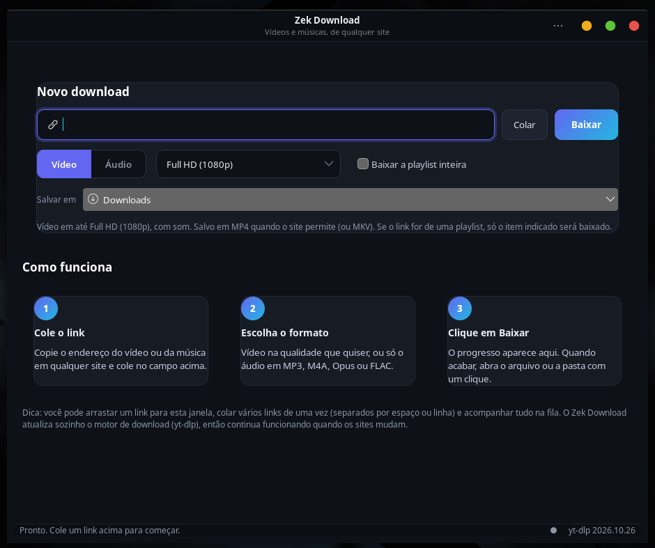

# Zek Download

Baixe **vídeos e músicas** de milhares de sites com uma interface simples e profissional.
Usa o [yt-dlp](https://github.com/yt-dlp/yt-dlp) por baixo — e **se mantém atualizado sozinho**.



## Instalar

**Linux Mint / Ubuntu / Debian**
```bash
sudo apt install ./zek-download_1.1.1_all.deb
```

**Fedora**
```bash
# Instale o RPM gerado pelo rpmbuild (válido no DNF):
sudo dnf install -y ~/rpmbuild/RPMS/noarch/zek-download-1.1.1-1.fc*.noarch.rpm

# Ou, se baixou o .rpm direto do GitHub release:
sudo dnf install -y --nogpgcheck zek-download-1.1.1-1.fc45.noarch.rpm
```

Depois abra **Zek Download** no menu de aplicativos (ou rode `zek-download`). Na primeira vez ele baixa o motor de
download (poucos segundos) — precisa de internet.

> Fedora: o `ffmpeg-free` dos repositórios oficiais já resolve a dependência de mesclagem de vídeo/áudio.  
> O `ffmpeg` completo vem do RPM Fusion.  
> YouTube: instale também o `nodejs` (já é "Recomendado" no pacote) — o yt-dlp usa para decifrar os links.

## Como usar
1. **Cole o link** (ou arraste para a janela).
2. Escolha **Vídeo** (qualidade) ou **Áudio** (MP3, M4A, Opus, FLAC).
3. Clique em **Baixar**. Acompanhe porcentagem, velocidade e tempo restante; ao terminar, abra o arquivo ou a pasta.

Dá para colar vários links de uma vez (viram uma fila) e baixar playlists inteiras.

## Como ele "se adapta" quando o yt-dlp muda
- **Não embute o yt-dlp.** Baixa o executável oficial para `~/.local/share/zek-download/bin` e confere o SHA-256.
- **Atualiza sozinho** ao abrir (no máx. a cada 6 h) e pelo menu → *Verificar atualização do motor*.
- **Autocura:** se um download falhar com sinais de "site mudou" (extractor quebrado, 403, formato indisponível…),
  o Zek Download atualiza o motor e **tenta de novo automaticamente**, sem você fazer nada.
- O app só passa **opções estáveis** do yt-dlp e lê o progresso por templates (`--progress-template`), que mudam
  muito pouco. Se uma opção sumir numa versão futura, o app faz fallback quando possível.
- Se a versão estável ainda não corrigiu, ative o canal **Nightly** em Configurações.


## Desenvolvimento
```bash
./build.sh                 # testes + gera dist/*.deb e dist/*.rpm
python3 tests/test_core.py # só os testes
```

Estrutura: `engine.py` (motor/atualização), `downloader.py` (links, argumentos, progresso, erros),
`manager.py` (fila + autocura), `app.py` (interface GTK 3), `settings.py`, `style.py` (tema).

Releases automáticos: ao pushar uma tag `v*` no GitHub, o [GitHub Actions](.github/workflows/release.yml)
gera os instaladores `.deb` e `.rpm` e anexa ao release.

Plano B no Fedora: `rpmbuild -bb --build-in-place packaging/zek-download.spec`.

### ⚠️ Aviso sobre direitos autorais

O Zek Download é uma ferramenta destinada ao download de conteúdos próprios, de domínio público ou cujo download tenha sido expressamente autorizado pelo titular dos direitos.

O usuário é inteiramente responsável pelo uso do programa e deve respeitar as leis de direitos autorais e os termos de serviço das plataformas utilizadas.

**Não utilize o Zek Download para baixar ou distribuir conteúdos protegidos sem a devida autorização.**. Veja `SECURITY.md` para detalhes de segurança.
Licença: MIT.
